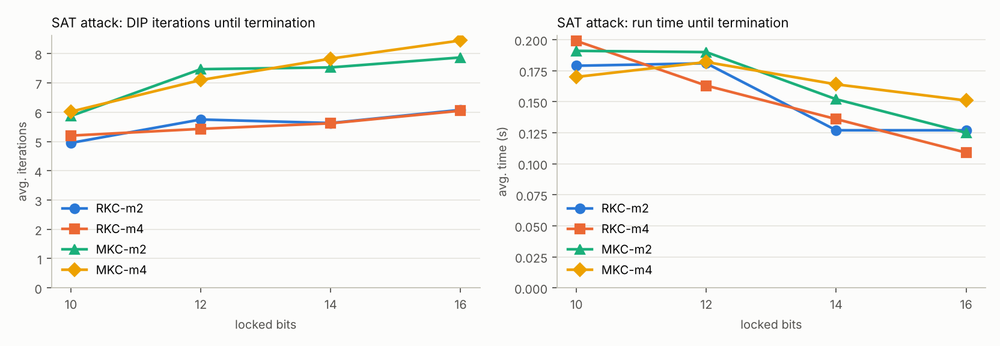
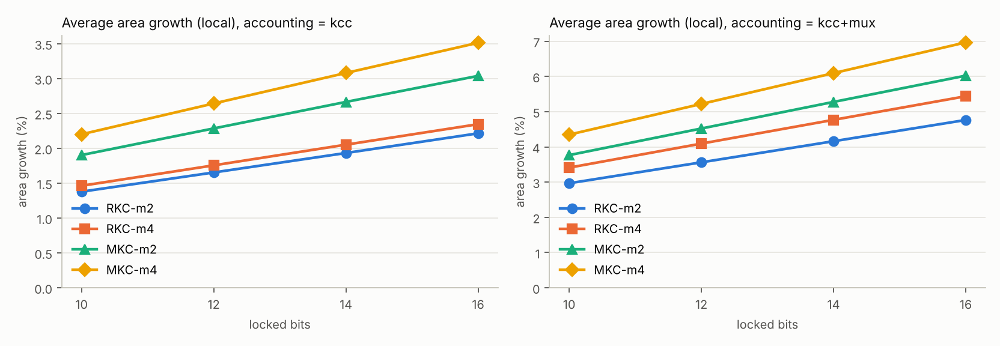

# Reproducing "Replacement-Based Key-Controlled Circuits" (RKC / MKC) with an AI agent

Paper: W. Wang, L. Zhao, S. Cai, *Replacement-Based Key-Controlled Circuits: A New
Lightweight Logic-Locking Technique to Prevent the SAT Attack and Its Variants*,
Appl. Sci. 2026, 16, 925. https://doi.org/10.3390/app16020925

The authors released no code. Everything here (locking tool, simulator, CNF
encoder, SAT attack, AppSAT, equivalence checker, experiment scripts) was written
from the paper by an AI agent (Claude) following the LockForge workflow
(forethought, implementation, refinement, validation). The agent interaction is
documented in [`docs/AGENT_LOG.md`](docs/AGENT_LOG.md) and
[`docs/lockforge/`](docs/lockforge).

## TL;DR of the reproduction

| Paper claim | Reproduced? | Evidence |
|---|---|---|
| Tables 1-4: the 24 key-controlled circuits are correct when the key comes from the LUT memory | Yes, 24/24 exhaustively | `results/exp1_*` |
| No single static (K1,K2) unlocks any of them | Yes, 24/24 | `results/exp1_*` |
| SAT attack ends after a few iterations with either "all keys eliminated" or a wrong key (Fig. 13) | Yes: 959/960 runs, avg 6.4 DIPs, avg 0.16 s | `results/exp2_*`, `fig13_sat_attack.png` |
| AppSAT fails on c1355 / 16 bits (Table 6) | Yes (no correct key in 80/80 runs), but iteration counts differ | `results/exp3_*` |
| Area grows linearly and slowly with locked bits; RKC < MKC (Fig. 14a) | Trend yes; absolute numbers and the fine ordering no (different tool + library) | `results/exp4*` |
| RKC can have negative per-gate area overhead (Fig. 15a) | No, always positive in our flow | `results/exp4_per_topology_area.csv` |
| Power overhead (Fig. 14b, 15b) | Not attempted | - |
| Comparison against GateLock, SKG-Lock(+), CAS-Lock | Not attempted | - |
| Brute-force counts, Eqs. (1)-(3) | Formulas evaluated | `results/exp6_bruteforce.csv` |

One finding goes beyond the paper and matters for how to read its security claim:
**if the attacker's netlist includes the MUX-based key memory (which is fabricated
logic), the ordinary SAT attack recovers a functionally correct key in 600/600 runs,
in about 10-16 DIPs at 16 locked bits and under 2 s at 128 locked bits** (Exp 5).
The SAT resistance in the paper's experiments comes from modelling K1/K2 as free
static key inputs, i.e. hiding the MUXes from the attacker.

## The scheme in one paragraph

A gate `Y = X(A,B)` (RKC) or a two-gate topology `W = AND(A,B); Y = X(W,C)` (MKC)
is deleted and replaced by a small AND-OR circuit over two key lines `K1,K2` and
the same inputs. `K1,K2` are not constants: each comes from a 2:1 MUX whose select
is a circuit input and whose data inputs are tamper-proof memory cells holding
(0, 1). For `m=2` both MUXes are selected by `A` (key 00 when A=0, 11 when A=1);
for `m=4` K1 follows `A` and K2 follows `B`. The replacement circuits are chosen so
that the right key differs between input sets, hence no single static key works.

## Layout

```
rkc/netlist.py     .bench parser/writer, bit-parallel simulator, Verilog export
rkc/kcc.py         Tables 1-4 verbatim + truth-table utilities + LUT-memory rule
rkc/lock.py        RKC/MKC locking (static / full views, 2x / 1x storage), RLL baseline
rkc/attacks.py     Tseitin encoder, SAT attack, AppSAT, equivalence check, error rate
rkc/cli.py         lock (and attack) one netlist from the command line
experiments/       one script per experiment, writes CSV/PNG into results/
benchmarks/        c1355, c5315, c7552 (ISCAS'85), des, i7, i8 (MCNC) in .bench
tests/             67 pytest checks
docs/lockforge/    forethought, checklist, examiner statements, validation prompts
docs/AGENT_LOG.md  prompts, errors, refinements
```

## How to run

```bash
pip install -r requirements.txt          # python-sat, matplotlib, pytest, yowasp-yosys
python -m pytest -q tests                # ~1 s
./run_all.sh                             # everything; attacks ~2 min, synthesis ~25 min on 2 cores
```

Individual steps:

```bash
python experiments/exp1_kcc_tables.py    # Tables 1-4 / Figs 4,6,9,11
python experiments/exp2_sat_attack.py    # Fig. 13
python experiments/exp3_appsat.py        # Table 6
python experiments/exp4_overhead.py      # Fig. 14a, 15a, Table 7 (area); downloads NanGate45 .lib on first run
python experiments/exp4b_local_area.py   # same, without whole-circuit resynthesis noise
python experiments/exp5_netlist_aware.py # extension: attacker sees the key memory
python experiments/exp6_bruteforce.py    # Eqs. (1)-(3)

# lock one circuit and attack it
python -m rkc.cli benchmarks/c1355.bench --scheme MKC-m4 --bits 16 --view static -o locked.bench --attack sat
python -m rkc.cli benchmarks/c1355.bench --scheme MKC-m4 --bits 16 --view full   -o full.v      --attack sat
```

No GPU is used. All randomness is seeded (seeds 0-9).

## Implementation notes

* **Views.** `static`: K1/K2 of each site are key inputs `keyinput<2i>, keyinput<2i+1>`
  (the paper's attack model; "locked bits" = number of these). `full`: the 2:1
  MUXes are in the netlist and the memory cells are the key inputs (`2x`: two cells
  per key line, correct value 0,1; `1x`: one cell plus inverter, correct value 0).
  The `full` view with correct cells is SAT-proven equivalent to the original.
* **Sites.** A site is a 2-input gate `X` with one fanin driven by a 2-input AND `W`.
  RKC replaces `X`; MKC replaces `X` and also deletes `W` if `W` has no other fanout
  (Sec. 4.2 / Fig. 12). Both schemes use the same randomly chosen sites per
  (circuit, bits, seed), as in Sec. 5.2.
* **Benchmarks.** The six `.bench` files are the standard HOST'15 SAT-attack set.
  They contain only AND/NAND/OR/NOR/NOT/BUF, so the XOR/XNOR circuits of Tables 1-4
  are verified exhaustively (Exp 1) but never instantiated in a benchmark.
  Gate counts match Table 5 for c1355, c5315, i8; c7552 has 3512 (paper 3513),
  des 6473 (paper 6437), i7 1315 gates (paper 1581, which is the file's line count).
* **Attacks.** Written from the original papers (Subramanyan HOST'15, Shamsi
  HOST'17) on PySAT/Glucose4, not Shamsi's C++ tool. Per-DIP constraints are
  constant-folded so only key-dependent logic is encoded. A returned key is
  classified with a SAT equivalence check, not sampling.

## Results

### Exp 1: Tables 1-4 (`results/exp1_kcc_properties.csv`, `exp1_truth_tables.md`)

All 24 expressions are correct for every circuit-input pattern when K1,K2 come from
the LUT memory, wrong on at least 1 pattern for each of the 4 static keys, and
depend on all of their inputs. The "completely irrelevant" (all-zero) key column is
K=10 for all six RKC-m2 circuits, as in Fig. 4, and exactly one MKC-m4 circuit
(AND-AND) has one, matching "five out of six ... do not contain" in Sec. 4.2.

### Exp 2: SAT attack, static-key model (Fig. 13)

6 circuits x 4 schemes x {10,12,14,16} bits x 10 seeds = 960 attacks.



| Outcome | Runs |
|---|---|
| All keys eliminated (constraints UNSAT, no key returned) | 544 |
| Wrong key returned (SAT-proven not equivalent) | 415 |
| Functionally correct static key returned | 1 |

Average 6.4 DIPs (max 15) and 0.16 s per attack (max 0.91 s), versus "several
iterations" and "several seconds" in the paper. Wrong keys corrupt the output on
26% of random input patterns on average (range 0.8% to 87%). Averages per scheme and
key size are in `results/exp2_sat_attack_summary.csv`.

The one exception (i8, MKC-m2, 10 bits, seed 9) is a case where the sites' failing
input patterns are unreachable or unobservable inside the circuit, so a static key
exists that is correct on every primary-input pattern. The paper's guarantee is
per gate ("at least one circuit input pattern is wrong"), which does not rule this
out at circuit level. It is rare (1/960) but shows site selection matters.

### Exp 3: AppSAT on c1355, 16 bits (Table 6)

Paper settings (50 random queries every 12 DIPs, settlement 5), 10 seeds:

| Scheme | Avg runtime (s) | Avg DIPs | Wrong key | No key | Correct key | Paper: runtime / iterations |
|---|---|---|---|---|---|---|
| RKC-m2 | 0.029 | 3.3 | 5 | 5 | 0 | 0.316 / 17 |
| RKC-m4 | 0.031 | 3.1 | 6 | 4 | 0 | 0.220 / 24 |
| MKC-m2 | 0.036 | 10.2 | 2 | 8 | 0 | 0.301 / 20 |
| MKC-m4 | 0.026 | 8.4 | 1 | 9 | 0 | 0.290 / 21 |

The conclusion matches (AppSAT never gets a correct key). The iteration counts do
not: in our runs the DIP loop usually ends before the first 12-DIP estimation round,
so AppSAT behaves like the plain SAT attack. The paper does not say which gates
were locked or how its tool counts iterations, so this cannot be resolved from the
text. With estimation every 2 DIPs, the failing random queries are added as
constraints and all keys are eliminated in 40/40 runs (`results/exp3_appsat_summary.csv`).

### Exp 4: area overhead (Fig. 14a, Fig. 15a, Table 7 area row)

Substitute flow: Yosys 0.71 + ABC, NanGate 45 nm typical library (paper: Synopsys DC,
TSMC 28 nm). Absolute um^2 are therefore not comparable.

Site-level ("local") accounting, average over 6 circuits and 10 seeds:



| um^2 per locked bit (NanGate45) | RKC-m2 | RKC-m4 | MKC-m2 | MKC-m4 |
|---|---|---|---|---|
| Key-controlled circuits only | 0.744 | 0.629 | 0.868 | 1.058 |
| + key-memory MUXes | 1.542 | 1.706 | 1.712 | 2.143 |
| Paper, Table 7 (TSMC 28) | 0.2275 | 0.1715 | 0.6930 | 0.4095 |

* Linear, slow growth with locked bits: reproduced.
* RKC cheaper than MKC, and RKC-m4 cheaper than RKC-m2: reproduced (circuits only).
* MKC-m4 cheaper than MKC-m2: not reproduced (reversed here).
* Negative per-gate overhead for some RKC circuits (Fig. 15a): not reproduced. Every
  one of the 24 circuits is larger than what it replaces, by 0.27 to 2.66 um^2
  (`results/exp4_per_topology_area.csv`).
* Counting the two MUXes per site roughly doubles the overhead. The paper's per-bit
  numbers are small enough that they appear to exclude the memory MUXes.

Whole-circuit re-synthesis (`results/exp4_overhead_summary.csv`,
`fig14a_area_overhead.png`) gives the same upward trend but is noisy: ABC
restructures logic far from the locked sites (c1355 grows 10-18% for 8 replaced
gates because locking breaks up its XOR trees; i7 and des sometimes shrink).

### Exp 5 (extension): attacker sees the key memory

Same SAT attack, `full` view, 6 circuits x 10 seeds at 16 locked bits, plus
des/i8 at 32-128 locked bits:

| Scheme | Locked bits | Storage | Equivalent key recovered | Avg DIPs | Avg time (s) |
|---|---|---|---|---|---|
| RKC-m2 / RKC-m4 / MKC-m2 / MKC-m4 | 16 | 2x | 60/60 each | 14.1 / 13.9 / 16.4 / 16.2 | 0.35 |
| same | 16 | 1x | 60/60 each | 10.1 / 10.2 / 9.9 / 11.8 | 0.32 |
| same (des, i8) | 128 | 2x | 10/10 each | 71 to 78 | 1.1 to 1.2 |
| RLL XOR baseline (attack sanity check) | 16 | - | 60/60 | 6.8 | 0.31 |

Exact values: `results/exp5_netlist_aware_summary.csv`. DIP count grows roughly
linearly with key size. Under this model RKC/MKC behave like a lightly obfuscated
XOR lock: with 1x storage each key line is literally `cell XOR circuit_input`.
Also note the correct cell contents are the same for every site by construction, so
there is no per-chip secret unless the designer randomises polarities.

### Exp 6: brute-force counts

For one site (k=2): b_max = 4, N_p = 60, N_total = 64. Larger k in
`results/exp6_bruteforce.csv`. This only evaluates the paper's formulas; it does
not test whether that counting argument is a meaningful security bound.

## Deviations and limitations

1. Power is not reproduced. No open flow gives numbers comparable to DC power reports.
2. GateLock, SKG-Lock, SKG-Lock+ and CAS-Lock are not implemented, so the paper's
   cross-scheme ordering and ratios are not checked.
3. Double-DIP, sensitization, removal and bypass attacks are argued, not run, in the
   paper; they are not implemented here either.
4. Synthesis tool and library differ (see Exp 4).
5. The schematics are figures; MUX wiring and the A/B/C assignment were inferred from
   the text and confirmed by exhaustive evaluation (`docs/lockforge/01_forethought.md`).
6. LockForge's independent Judge/Examiner agents (code-only, fresh context) have not
   been run yet; prompts and statements are prepared in `docs/lockforge/`.

## Third-party material

Benchmarks are the public ISCAS'85 / MCNC netlists in the form distributed with the
HOST'15 SAT-attack benchmark set (fetched from the `gatelabdavis/RANE` GitHub
mirror). The NanGate 45 nm Open Cell Library is downloaded at run time from
OpenROAD-flow-scripts and is not redistributed here.
